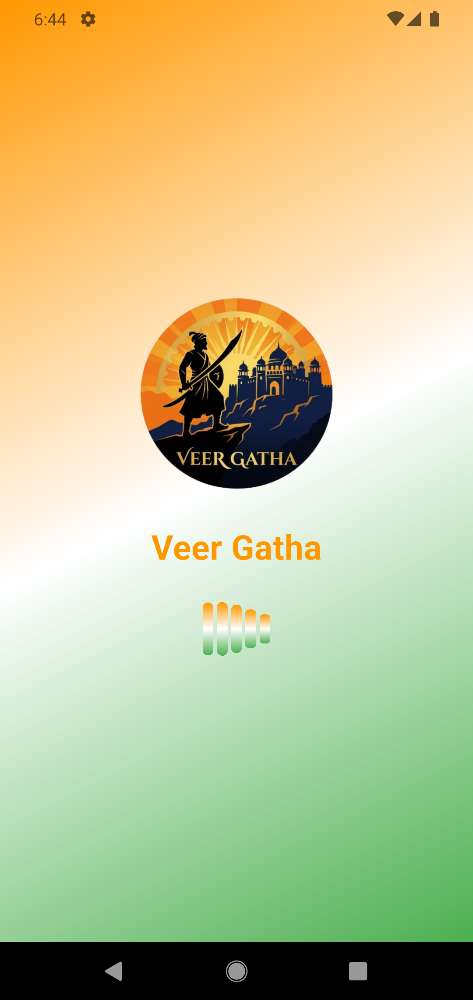
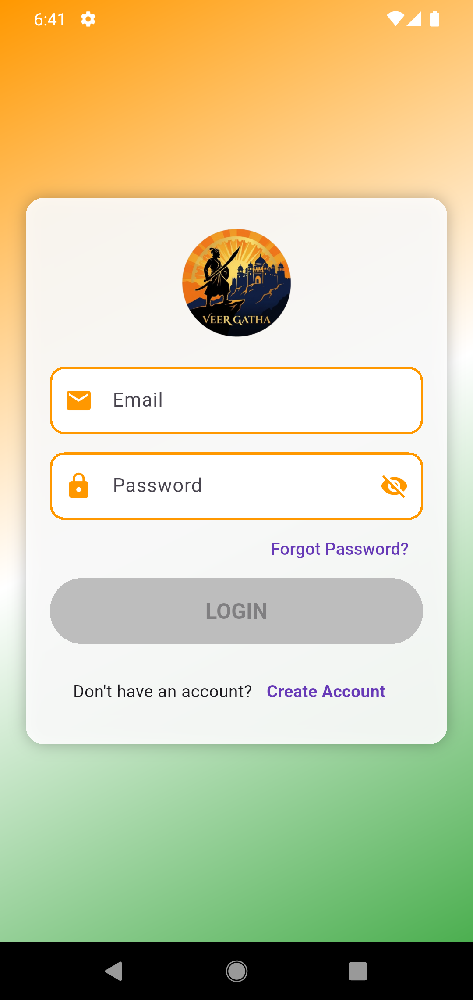
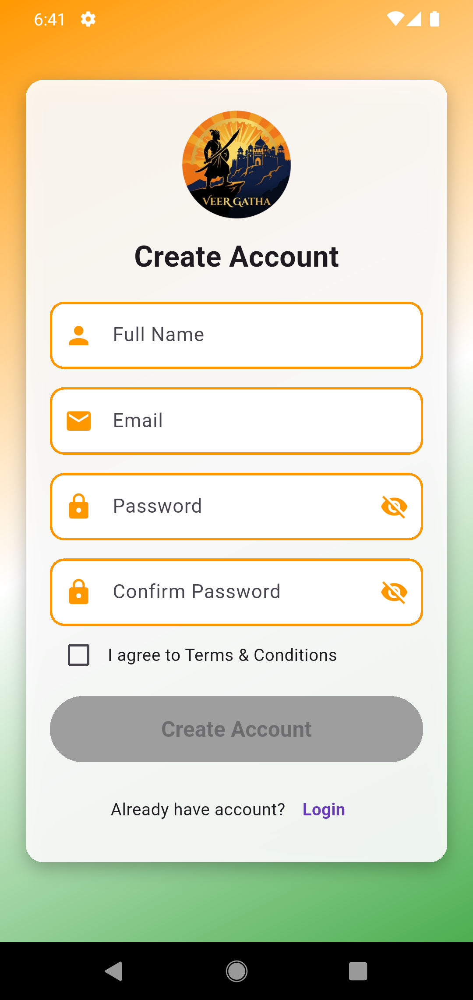
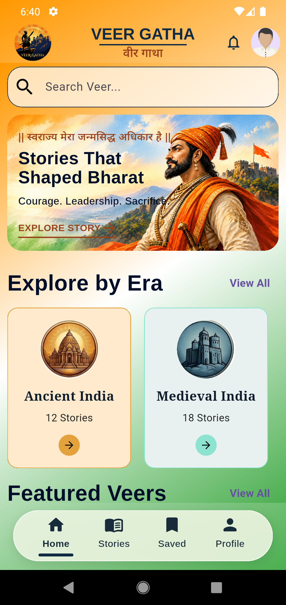
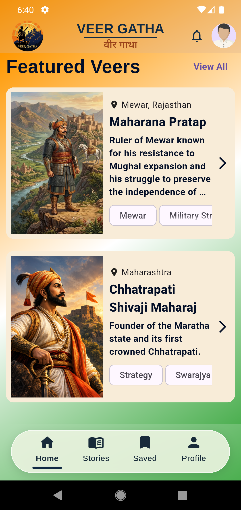
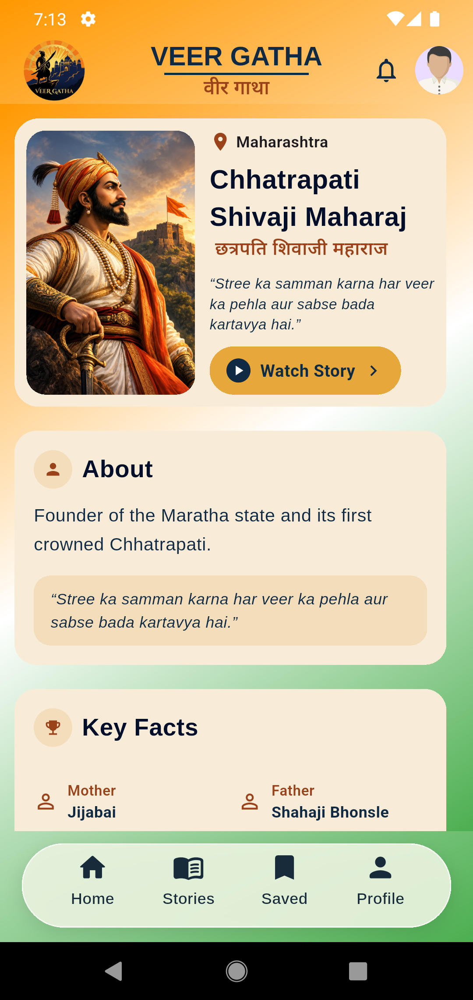
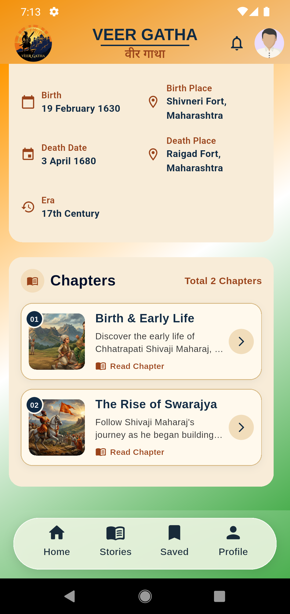
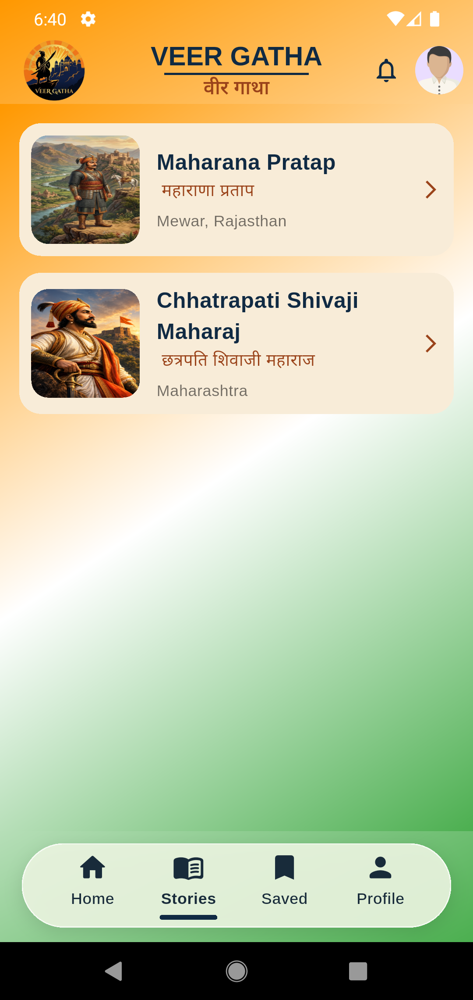
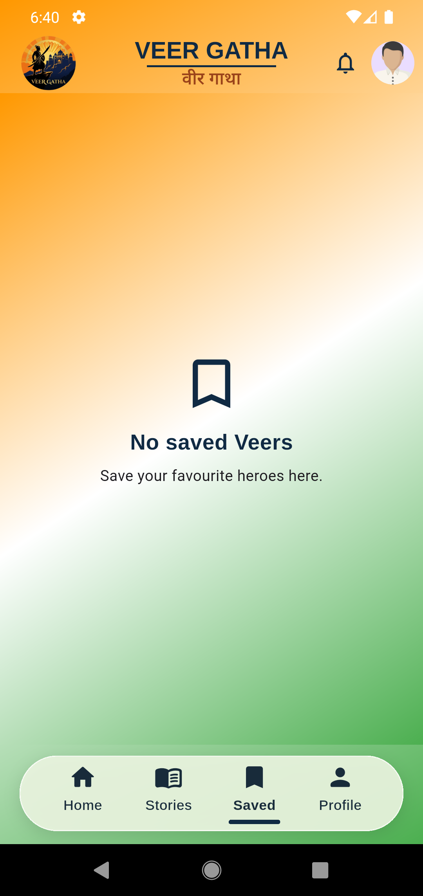
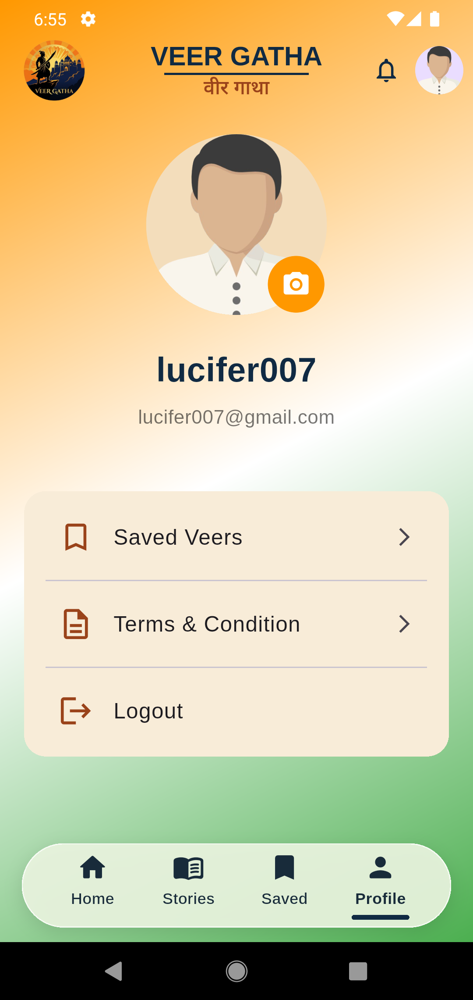

# 🛡️ Veer Gatha

**Veer Gatha** is a Flutter-based historical storytelling application focused on the lives, stories, chapters, and achievements of Indian historical heroes (_Veers_).

The app uses **Firebase Authentication, Cloud Firestore, Firebase Storage, GoRouter, and Skeleton Loading** to provide a structured and responsive reading experience.

---

## ✨ Features

- 🔐 **Firebase Authentication** – Email/password signup, login and logout.
- 🏠 **Home Screen** – Hero section, historical categories and featured content.
- 🧑‍⚔️ **Veers Collection** – Historical personalities are loaded from Firestore.
- 📖 **Chapter & Section Reading** – Veer → Chapter → Section navigation.
- 🔎 **Search** – Search historical personalities from Firestore data.
- 💾 **Save Veers** – Logged-in users can save and remove favourite Veers.
- 📈 **Reading Progress** – Chapter/section reading progress is stored per user.
- 👤 **Profile** – User profile and profile-photo update.
- ☁️ **Firebase Storage** – Profile images are uploaded to Firebase Storage.
- ⏳ **Skeleton Loading** – Loading states are shown while data is being fetched.
- 🧭 **GoRouter Navigation** – Centralised route management with authentication redirects.
- 📱 **Responsive Flutter UI** – Designed for mobile-first historical storytelling.

---

## 🛠️ Tech Stack

| Technology       | Purpose                              |
| ---------------- | ------------------------------------ |
| Flutter          | Cross-platform UI development        |
| Dart             | Application programming language     |
| Firebase Core    | Firebase initialization              |
| Firebase Auth    | User authentication                  |
| Cloud Firestore  | Veer, chapter, section and user data |
| Firebase Storage | Profile-photo storage                |
| GoRouter         | Application routing                  |
| Google Fonts     | Typography                           |
| Skeletonizer     | Skeleton loading UI                  |
| Image Picker     | Selecting profile images             |

---

## 📂 Project Structure

```text
lib/
├── layouts/
│   ├── app_header.dart
│   ├── app_footer.dart
│   └── main_layout.dart
│
├── routes/
│   └── app_routes.dart
│
├── services/
│   └── auth_service.dart
│
├── screens/
│   ├── splash_screen.dart
│   ├── login_screen.dart
│   ├── signup_screen.dart
│   ├── home_screen.dart
│   ├── search_screen.dart
│   ├── veers_grid_screen.dart
│   ├── veer_detail_screen.dart
│   ├── chapter_detail_screen.dart
│   ├── section_detail_screen.dart
│   ├── stories_screen.dart
│   ├── eras_grid_screen.dart
│   ├── saved_screen.dart
│   ├── profile_screen.dart
│   └── coming_soon_screen.dart
│
├── widgets/
│   ├── app_background.dart
│   ├── hero_card.dart
│   ├── custom_card.dart
│   ├── custom_textfield.dart
│   ├── chapter_list.dart
│   ├── chapter_tile.dart
│   ├── section_header.dart
│   ├── section_timeline_tile.dart
│   ├── fact_grid_item.dart
│   └── skeleton_loaders.dart
│
├── firebase_options.dart
└── main.dart
```

---

## 🔥 Firebase Data Structure

The application uses a hierarchical Firestore structure:

```text
veers/
  └── {veerId}/
      ├── name
      ├── image
      ├── description
      └── chapters/
          └── {chapterId}/
              ├── title
              ├── description
              └── sections/
                  └── {sectionId}/
                      ├── title
                      ├── content
                      └── order

users/
  └── {uid}/
      ├── savedVeers/
      │   └── {veerId}
      └── progress/
          └── {veerId}_{chapterId}
```

> **Important:** `veerId`, `chapterId` and `sectionId` are used as Firestore document IDs for detail-page routing and nested data access.

---

## 🧭 Application Routes

| Route                                                 | Screen         |
| ----------------------------------------------------- | -------------- |
| `/splash`                                             | Splash Screen  |
| `/login`                                              | Login          |
| `/signup`                                             | Signup         |
| `/home`                                               | Home           |
| `/search`                                             | Search         |
| `/veers`                                              | Veers Grid     |
| `/eras`                                               | Eras Grid      |
| `/stories`                                            | Stories        |
| `/saved`                                              | Saved Veers    |
| `/profile`                                            | Profile        |
| `/veer/:veerId`                                       | Veer Detail    |
| `/veer/:veerId/chapter/:chapterId`                    | Chapter Detail |
| `/veer/:veerId/chapter/:chapterId/section/:sectionId` | Section Detail |
| `/coming-soon`                                        | Coming Soon    |

---

## 📸 Screenshots

Add application screenshots inside:

```text
docs/
└── screenshots/
    ├── splash.png
    ├── login.png
    ├── signup.png
    ├── home.png
    ├── veers.png
    ├── veer-detail.png
    ├── chapter-detail.png
    ├── section-detail.png
    ├── saved.png
    └── profile.png
```

Once the images are added, they can be displayed in this README like this:

### Splash



### Login



### Signup



### Home




### Veer Detail




### Stories



### Saved



### Profile



---

## 🎥 Screen Recording

The README also supports a **screen-recording/demo section**.

Save the final recording here:

```text
assets/
    └──images/
        └── screen-recording.mp4
```

**▶️ [Watch Veer Gatha Screen Recording](assets/images/screenRecording.mp4)**

### Recommended Recording Flow

1. Open the app.
2. Show the Splash Screen.
3. Login/Signup.
4. Open the Home Screen.
5. Open a Veer.
6. Open a Chapter.
7. Open a Section.
8. Demonstrate reading/progress.
9. Save a Veer.
10. Open Profile and demonstrate profile-photo update.
11. Return to the Home Screen.

---

## 🚀 Getting Started

### 1. Clone / open the project

```bash
git clone <https://github.com/RahulPirwani007/veer_gatha>
cd veer_gatha
```

### 2. Install dependencies

```bash
flutter pub get
```

### 3. Configure Firebase

The project already contains Firebase configuration files generated for the Flutter application. Make sure the Firebase project used by the app has the required services enabled:

- Firebase Authentication
- Cloud Firestore
- Firebase Storage

If you configure Firebase for a different project, regenerate the Flutter Firebase configuration and replace the project-specific configuration files.

### 4. Run the application

```bash
flutter run
```

For a specific device:

```bash
flutter devices
flutter run -d <device-id>
```

---

## 📦 Useful Commands

```bash
# Install packages
flutter pub get

# Check code
flutter analyze

# Run tests
flutter test

# Run the application
flutter run

# Build Android APK
flutter build apk
```

---

## 🔐 Authentication Flow

The app uses `FirebaseAuth.instance.currentUser` to determine whether the user is authenticated.

The GoRouter configuration protects application pages:

```text
Not logged in
    ↓
Login / Signup
    ↓
Authenticated
    ↓
Home → Veers → Chapters → Sections
```

If a logged-in user tries to open Login/Signup, the router redirects them to `/home`.

---

## 💾 Saved Veers & Reading Progress

Saved Veers are stored under the authenticated user's document:

```text
users/{uid}/savedVeers/{veerId}
```

Reading progress is stored using a combined document ID:

```text
users/{uid}/progress/{veerId}_{chapterId}
```

This allows the application to keep user-specific reading state separately from the public Veer content.

---

## 👤 Profile Photo

The profile screen uses `image_picker` to select an image and Firebase Storage to upload it.

The flow is:

```text
Gallery
   ↓
Image Picker
   ↓
Selected Image
   ↓
Firebase Storage
   ↓
Profile Photo
```

---

## 🎨 Assets

Application images are stored in:

```text
assets/images/
```

Current project assets include:

- `logo.png`
- `hero.png`
- `ancient.png`
- `freedom.png`
- `medieval.png`
- `women.png`
- `user.png`

---

## 🧪 Testing

Run Flutter tests with:

```bash
flutter test
```

Static analysis can be checked with:

```bash
flutter analyze
```

---

## 📌 Project Status

**Status:** Active development 🚧

The project is structured for adding more Veers, historical eras, chapters, sections, stories and user features through Firebase.

---

## 👨‍💻 Author

**Veer Gatha** – Historical storytelling Flutter application.

---

## 📄 License

Add your preferred project license here, for example MIT, if you plan to publish the project publicly.
